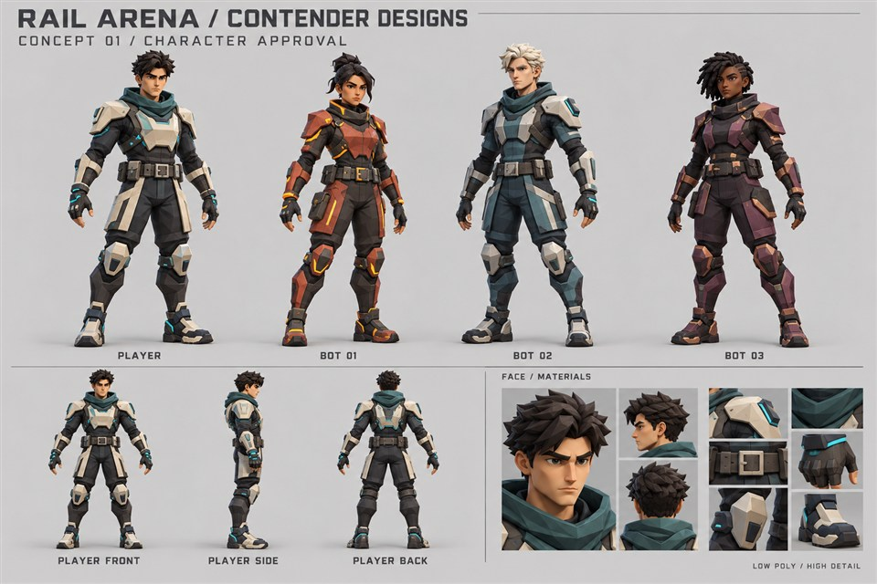
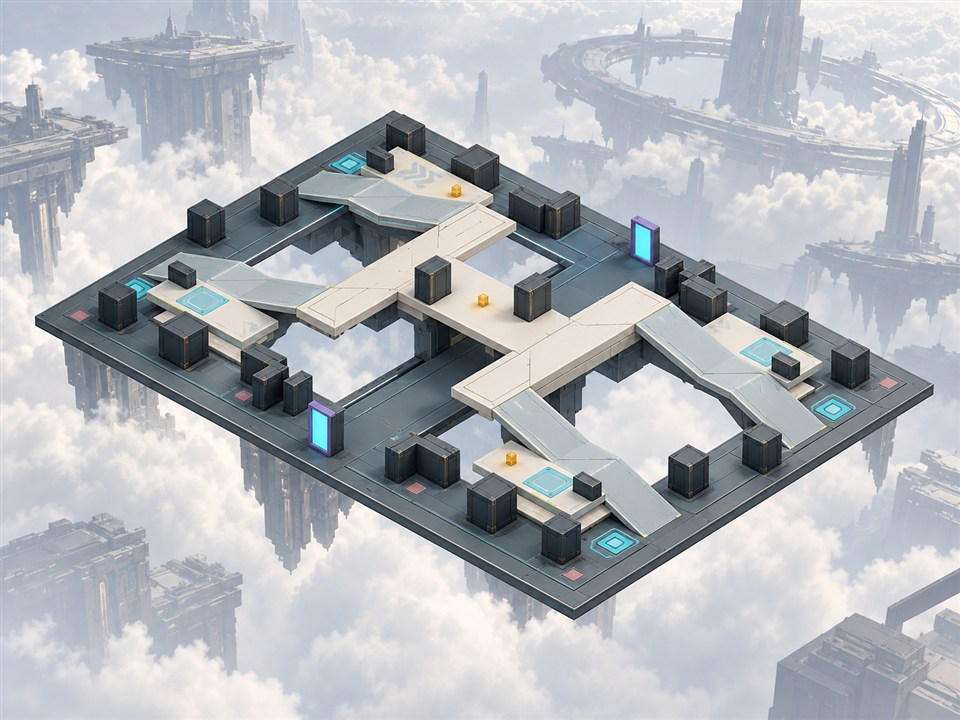

# Sanders Riddle

**Systems architect · AI engineer · Software engineer · Game designer & developer**

I build practical software and interactive worlds around how people work and play. My work connects system design, backend engineering, automation and AI with game rules, player feedback and real-time systems.

**Security is non-negotiable.** Access boundaries, input validation, privacy and careful handling of sensitive data belong in the design from the start.

[Explore my work](#selected-work) · [How I build](#how-i-build) · [Tools & experience](#tools--experience) · [Background](#background) · [Get in touch](#lets-build-something)

## Selected work

### Rail Arena

**Game design & development** · Public source · Windows pre-alpha

A precision-focused sci-fi arena shooter that makes aim practice feel like play. One railgun, momentum-driven movement and a compact battlefield put timing, positioning and readable feedback at the center of the experience.

- **Play:** solo practice, configurable gameplay bots, combat, jump pads, health pickups, scoring and match/rematch flow. Shared simulation rules support offline play and online duels.
- **Connect:** two-human direct-IP duels with host-owned movement and damage. Client prediction keeps movement responsive; reconciliation corrects it to the host's state. Bounded hit rewind checks shots against recent target positions.
- **Create:** arena layouts, weapon handling, first-person presentation, editable Blender sources and Unity authoring tools. Concept references and third-party asset provenance are documented separately from installed game content.
- **Verify:** C# simulation/networking tests, malformed-input checks, lifecycle tests and build-specific validation records. Development is AI-assisted; the in-game bots use gameplay logic, not language models.

**Built with:** C# · Unity 6.6 · URP · Blender · NUnit

**Recent work on `main`:** saved aim, reticle, comfort and audio settings; portrait-based appearance selection; combat statistics and feedback; and clearer lighting, pickup and traversal cues. Public design notes and build-specific checks document these changes.

> **Playable, still developing.** The downloadable Windows pre-alpha is an older checkpoint and does not include these newer source improvements. Final human input/audio review, real-internet duel acceptance and measured rendering performance remain open. Foundry v2, portals and revised gameplay rules remain pending work rather than released-client features.

[View project →](https://github.com/Evekiio/rail-arena) · [Windows pre-alpha](https://github.com/Evekiio/rail-arena/releases/tag/v0.1.0-pre-alpha.1) · [Design](https://github.com/Evekiio/rail-arena/blob/main/docs/DESIGN.md) · [Validation](https://github.com/Evekiio/rail-arena/blob/main/docs/VALIDATION.md)

**Inside the design process · AI-generated concept studies**

  
  

**Character direction:** the approved appearance target for the player and three bots. **Foundry arena:** an art-over informed by a measured layout, still a review candidate. These are visual design references, not gameplay captures or proof of released features. Open either image for its original source.

[Character provenance](https://github.com/Evekiio/rail-arena/blob/f805fbd32129999955c31fa659e5ea0092102ba5/docs/STYLIZED-CONTENDERS.md) · [Foundry sources & review limits](https://github.com/Evekiio/rail-arena/blob/f805fbd32129999955c31fa659e5ea0092102ba5/ArtSource/Original/Foundry-Arena-v2/References-v1/README.md) · [Artwork credits](assets/rail-arena-artwork-NOTICE.md)

### Windows System Audit

**Practical software & automation** · Public source · Implemented local utility

A PowerShell tool that turns Windows hardware, operating-system, GPU, storage and network information into readable text and structured JSON reports. It helps compare PCs and plan development or local-AI workloads.

Reports can contain identifying machine details, so review them before sharing. This is a planning utility, not a security assessment or an actual language-model benchmark.

[View project →](https://github.com/Evekiio/windows-system-audit) · [Source](https://github.com/Evekiio/windows-system-audit/blob/main/full_system_audit.ps1) · [Run guide](https://github.com/Evekiio/windows-system-audit#how-to-run)

## Architecture & AI collaboration

Concept-level overviews of work beyond the public projects above.

### Standing Orders

**AI-agent collaboration** · Reusable role manuals

A library of detailed role manuals for AI agents, with versioned PDF/source editions, team-composition guidance and a catalog. Clear responsibilities and engineering standards help coordinate the work, with security and human verification central to the process.

### Morrow

**Systems & product architecture** · Ecosystem overview

A modular, self-hosted business ecosystem: a shared foundation for websites, customers, appointments and checkout, with focused uses such as farmstead shops and print-on-demand stores. The design centers on Go with HTML, CSS and JavaScript. This portfolio summarizes the ecosystem concept; implementation and delivery details are kept outside this public overview.

## How I build

**Purpose before complexity.** Start with the workflow or player decisions, define the constraints and make the intended experience concrete.

**Clear boundaries.** Decide which system owns each result. Validate untrusted inputs, limit data access and favor readable code, explicit interfaces and documented asset provenance.

**Evidence over assumptions.** Use focused feature branches, meaningful commits and locally validated pull requests into `main`. Record what was checked and keep implemented behavior separate from approved designs and open acceptance work. Publication remains an explicit step, including any approved manual publisher. Human judgment still matters for usability, game feel and creative quality.

## Tools & experience

- **Games:** C#, Unity 6.6, URP, Blender, NUnit.
- **Systems & automation:** Go, Python, PowerShell, REST APIs, JSON workflows.
- **Web:** HTML, CSS, JavaScript, React, PHP, WordPress, MySQL.
- **AI & documents:** AI-assisted development, document processing, retrieval-augmented generation (RAG), Ollama and local AI integrations.
- **Enterprise background:** SAP Fiori, UI5, ABAP and OData services.

## Background

**United States Air Force veteran**

December 2007–April 2021 · Approximately 13 years, 4 months

Before moving into software, I maintained F-15 aircraft and led maintenance teams. That experience shaped how I troubleshoot, document technical work and follow careful procedures under real operating constraints.

My **MBA in Information Systems Management** supports how I connect technical decisions with business requirements and organizational needs.

## Let's build something

Interested in thoughtful software, game systems or AI-assisted engineering? Connect on [LinkedIn](https://www.linkedin.com/in/sandersriddle/) or explore my [public repositories](https://github.com/Evekiio?tab=repositories&type=public).

Original AI-generated portfolio artwork. Conceptual imagery, not a project screenshot.
