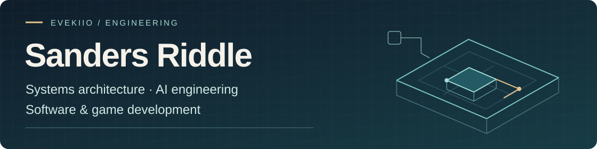

<picture>
  <source media="(max-width: 600px)" srcset="assets/portfolio-banner-mobile-v4.svg">
  
</picture>

**I build practical software, AI-assisted workflows and real-time game systems.** My focus is turning complex requirements into understandable systems, with clear ownership, security boundaries and evidence that others can inspect.

[Selected work](#selected-work) · [How I build](#how-i-build) · [Technical toolkit](#technical-toolkit) · [Background & contact](#background--contact)

## Selected work

### 01 / Rail Arena
**Game systems · Public source · Windows pre-alpha**  
C# · Unity 6.6 / URP · Blender · NUnit

A railgun-only sci-fi arena shooter built around aim, momentum and positioning. Solo practice, combat bots and two-player direct-IP duels share the same simulation rules.

- **Design & implementation:** gameplay design, C# simulation, host-authoritative networking and editable asset pipelines.
- **Engineering decisions:** client prediction and reconciliation for responsive movement; bounded hit rewind for shot checks against recent target positions.
- **Evidence:** build-specific validation and explicit acceptance limits. AI assists development and concept exploration; in-game bots use gameplay logic.

[Explore source](https://github.com/Evekiio/rail-arena) · [Download pre-alpha](https://github.com/Evekiio/rail-arena/releases/tag/v0.1.0-pre-alpha.1) · [Design](https://github.com/Evekiio/rail-arena/blob/main/docs/DESIGN.md) · [Validation](https://github.com/Evekiio/rail-arena/blob/main/docs/VALIDATION.md)

> **Development boundary:** source is ahead of the downloadable Windows checkpoint. Human input/audio review, real-internet duel acceptance and measured rendering performance remain open. Foundry v2, portals and revised match rules are not yet integrated.

<strong>Engineering detail & visual development</strong>

Current source includes saved aim, reticle, comfort and audio settings; portrait-based appearance selection; combat statistics and feedback; and clearer arena lighting, pickup and traversal cues. Simulation/networking tests, malformed-input checks and lifecycle tests are documented in the project, with limits attached to each build.

**AI-generated concept studies — design references, not gameplay captures**

  
  

**Character direction:** the approved appearance target for the player and three bots. **Foundry arena:** an art-over informed by a measured layout, still a review candidate. These are visual design references, not gameplay captures or proof of released features. Open either image for its original source.

[Character provenance](https://github.com/Evekiio/rail-arena/blob/f805fbd32129999955c31fa659e5ea0092102ba5/docs/STYLIZED-CONTENDERS.md) · [Foundry sources & review limits](https://github.com/Evekiio/rail-arena/blob/f805fbd32129999955c31fa659e5ea0092102ba5/ArtSource/Original/Foundry-Arena-v2/References-v1/README.md) · [Artwork credits](assets/rail-arena-artwork-NOTICE.md)

---

### 02 / Windows System Audit
**Systems tooling · Public source · Implemented local utility**  
PowerShell · Windows · JSON

A local PC inspection tool that turns hardware and Windows information into readable text and structured JSON for inventory, troubleshooting and workload planning.

- **Useful output:** explicit `OK`, `Unavailable` and `Skipped` states make collection gaps visible.
- **Privacy-conscious defaults:** identifying machine details are omitted, files use unique names and no reports are uploaded.
- **Controlled scope:** disk benchmarking is opt-in. Reports still contain hardware inventory and Windows versions and should be reviewed before sharing.

[Explore source](https://github.com/Evekiio/windows-system-audit) · [Run guide](https://github.com/Evekiio/windows-system-audit#quick-start) · [Privacy & limitations](https://github.com/Evekiio/windows-system-audit#privacy-and-security)

*An inspection and planning utility, not a security assessment or a guarantee of AI workload performance.*

---

### 03 / Architecture & AI workflows
**Selected high-level concepts · Source and internal materials not shared here**

**Standing Orders** explores clear responsibilities, bounded procedures and accountable handoffs for AI-assisted work. The focus is on instructions people can review, not a promise of autonomous performance.

**Morrow** is a modular, self-hosted business ecosystem designed around a shared foundation for websites, customers, appointments and checkout. Go, HTML, CSS and JavaScript inform its architecture; implementation and delivery details remain outside this overview.

These summaries are intentionally limited. They do not publish internal manuals, client information or private implementation artifacts.

## How I build

**Understand the work.** Start with the user workflow or player decision, the accountable owner and the evidence needed for acceptance.

**Design the boundaries.** Apply least privilege, validate untrusted inputs and make interfaces, failure paths and asset provenance explicit.

**Keep the work inspectable.** Use focused branches, meaningful commits and locally validated pull requests. Distinguish implemented behavior, approved concepts and open acceptance work. Human judgment still decides usability and game feel.

## Technical toolkit

- **Systems & automation:** Go, Python, PowerShell, REST APIs and JSON workflows.
- **AI & documents:** AI-assisted development, document processing, RAG, Ollama and local AI integrations.
- **Games & real-time:** C#, Unity 6.6, URP, Blender and NUnit.
- **Web & enterprise:** HTML, CSS, JavaScript, React, PHP, WordPress, MySQL; SAP Fiori, UI5, ABAP and OData.

## Background & contact

**United States Air Force veteran · December 2007–April 2021**  
Maintaining F-15 aircraft and leading maintenance teams shaped how I troubleshoot, document technical work and operate within real constraints. My **MBA in Information Systems Management** helps connect engineering decisions with business needs.

Interested in software, game systems or AI-assisted engineering?

**[Connect on LinkedIn](https://www.linkedin.com/in/sandersriddle/)** · **[Browse public repositories](https://github.com/Evekiio?tab=repositories&type=public)**

Manually maintained portfolio. Original vector identity artwork; concept images are labeled and credited. [Maintenance guide](PROFILE-MAINTENANCE.md).
