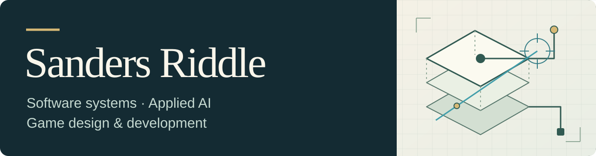

# Sanders Riddle

**AI engineering · software systems · workflow automation**

I design and build software that turns operational needs into usable systems. My work spans document processing, retrieval-augmented generation (RAG), agent-based workflows, backend services and REST APIs, and user-facing applications. I also work at the boundary between engineering and business analysis: understanding a workflow, defining what a solution needs to do, building a practical prototype, and planning how it can fit into existing systems.

Security is a non-negotiable requirement in how I design and build systems. I consider authentication, access boundaries, sensitive-data handling, and reviewability alongside privacy, reliability, and maintainability. I do not treat a working demo as the end of the engineering work.

[My work](#what-i-work-on) · [Public project](#public-project) · [Background](#background) · [Connect](#connect)

## What I work on

- **AI and document workflows:** document processing, RAG, local language-model integrations, and agent-based tasks that support real work.
- **Backend systems and automation:** Go and Python services, JSON-based pipelines, REST APIs, and integrations that connect applications and processes.
- **Web applications:** interfaces and features built with React, JavaScript, HTML, CSS, WordPress, PHP, and MySQL.
- **Enterprise applications:** prior work with SAP Fiori and UI5 applications backed by ABAP and OData services.
- **Solution planning:** translating business requirements into technical designs, prototypes, and implementation plans, with security and operational fit considered from the start.

My self-hosted engineering work has included Go and Python services, automation pipelines, and local AI integrations using Ollama. Those projects have given me a place to practice implementation, debugging, documentation, and secure coding without presenting private work as public portfolio material.

## Public project

**[Windows System Audit](https://github.com/Evekiio/windows-system-audit)** is a local PowerShell script for collecting Windows hardware, operating-system, GPU, storage, network, WSL, and NVIDIA readiness information. It produces human-readable text and structured JSON reports for inspection and further automation. The linked repository shows the public code currently available on its main branch.

## Background

Before moving into software, I served 13 years in the United States Air Force maintaining F-15 aircraft and leading maintenance teams. That experience shaped my approach to troubleshooting, technical documentation, safety procedures, and work that needs to be dependable under real constraints.

I hold an MBA in Information Systems Management, which supports how I connect technical decisions with business requirements and organizational needs.

## Connect

[LinkedIn](https://www.linkedin.com/in/sandersriddle/) · [GitHub repositories](https://github.com/Evekiio?tab=repositories)
