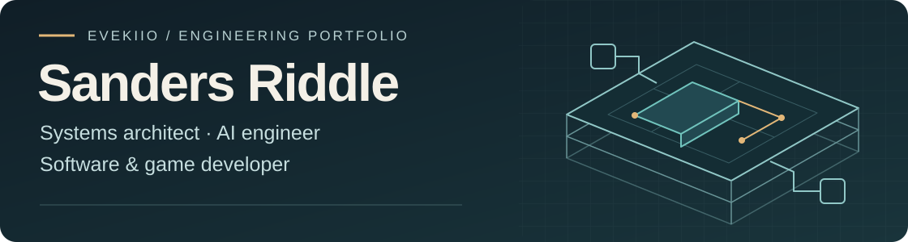
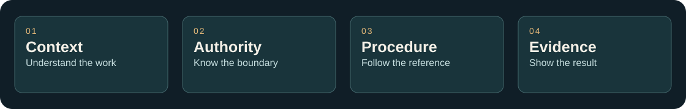

<picture>
  <source media="(max-width: 600px)" srcset="assets/portfolio-banner-mobile-v3.svg">
  
</picture>

**I'm Sanders Riddle, a systems architect, AI engineer and software developer who also designs and builds games.** I work across practical tools, AI-assisted workflows and real-time systems, with clear ownership, security boundaries and inspectable evidence built into the process.

[Selected work](#selected-work) · [Engineering approach](#engineering-approach) · [Experience & contact](#experience--contact)

## Selected work

### Rail Arena
**Game design & development · Public source · Windows pre-alpha**  
C# · Unity 6.6 / URP · Blender · NUnit

A railgun-only sci-fi arena shooter built around aim, momentum and positioning. Solo practice, configurable combat bots and two-player direct-IP duels share the same simulation rules.

**My work spans** gameplay design, C# simulation, host-authoritative networking, editable asset pipelines and build-specific validation. Client prediction and reconciliation support responsive movement; bounded hit rewind checks shots against recent target positions. AI assists development and concept exploration; the in-game bots use gameplay logic.

[Source](https://github.com/Evekiio/rail-arena) · [Download pre-alpha](https://github.com/Evekiio/rail-arena/releases/tag/v0.1.0-pre-alpha.1) · [Design](https://github.com/Evekiio/rail-arena/blob/main/docs/DESIGN.md) · [Validation](https://github.com/Evekiio/rail-arena/blob/main/docs/VALIDATION.md)

> **Current source is ahead of the download.** The Windows ZIP is an older playable checkpoint. Human input/audio review, real-internet duel acceptance and measured rendering performance remain open. Foundry v2, portals and revised match rules are not integrated into current gameplay.

<strong>Engineering detail & visual development</strong>

Current source includes saved aim, reticle, comfort and audio settings; portrait-based appearance selection; combat statistics and feedback; and clearer arena lighting, pickup and traversal cues. Simulation/networking tests, malformed-input checks and lifecycle tests are documented in the project, with limits attached to each build.

**AI-generated concept studies — design references, not gameplay captures**

  
  

**Character direction:** the approved appearance target for the player and three bots. **Foundry arena:** an art-over informed by a measured layout, still a review candidate. These are visual design references, not gameplay captures or proof of released features. Open either image for its original source.

[Character provenance](https://github.com/Evekiio/rail-arena/blob/f805fbd32129999955c31fa659e5ea0092102ba5/docs/STYLIZED-CONTENDERS.md) · [Foundry sources & review limits](https://github.com/Evekiio/rail-arena/blob/f805fbd32129999955c31fa659e5ea0092102ba5/ArtSource/Original/Foundry-Arena-v2/References-v1/README.md) · [Artwork credits](assets/rail-arena-artwork-NOTICE.md)

---

### Standing Orders
**AI-agent collaboration · Versioned reference library · Private project overview**

Standing Orders turns a job into a reference an AI agent can follow: what context to gather, which procedure applies, where its authority ends and what evidence to return. It makes responsibilities and handoffs explicit before execution begins.

**The system connects** reusable role manuals, bounded workflows, prerequisites, output templates and acceptance checks. Editable sources and versioned PDF editions support traceable instructions; team-composition guidance helps coordinate roles without expanding their permissions.

**Beyond the manuals, I built review tooling** to check edition integrity, assemble traceable review packages and test boundary cases with deterministic fixtures. These checks support an accountable review process; they do not establish how reliably an agent will perform a real job.

<picture>
  <source media="(max-width: 600px)" srcset="assets/standing-orders-boundaries-mobile-v1.svg">
  
</picture>

*Context → authority → procedure → evidence. A reference model for accountable work, with the receiving operator responsible for permissions and adoption.*

The value is a result someone can inspect and a clear next accountable owner. Security boundaries and human verification are part of the design. Initial editions require human adoption review; planning outlines do not establish implemented procedures, a deployed agent team or guaranteed autonomy. This summary shares the architecture at a high level; private manuals and internal artifacts are not distributed here.

<strong>Additional architecture: Morrow</strong>

**Systems & product architecture · Private project overview**

A modular, self-hosted business ecosystem with a shared foundation for websites, customers, appointments and checkout. Focused uses include farmstead shops and print-on-demand stores. The design centers on Go with HTML, CSS and JavaScript; implementation and delivery details remain outside this public overview.

---

### Windows System Audit
**Software & automation · Public source · Implemented local utility** 
PowerShell · Windows · JSON

A local PC inspection tool that turns hardware and Windows information into readable text and structured JSON reports. It supports inventory, troubleshooting and workload planning without uploading the collected reports.

**Engineering focus:** explicit `OK`, `Unavailable` and `Skipped` states keep collection gaps visible. Identifying machine details are omitted by default, output files use unique names, and disk benchmarking is opt-in.

[Source](https://github.com/Evekiio/windows-system-audit/blob/main/full_system_audit.ps1) · [Run guide](https://github.com/Evekiio/windows-system-audit#quick-start) · [Privacy & limitations](https://github.com/Evekiio/windows-system-audit#privacy-and-security)

Reports still expose hardware inventory and Windows versions: review them before sharing. This is a planning utility, not a security assessment or proof that an AI model will run well.

---

## Engineering approach

- **Start with the work.** Define the user workflow or player decision, system ownership and acceptance evidence before adding complexity.
- **Design the boundaries.** Apply least privilege, validate untrusted inputs and handle sensitive data carefully. Keep interfaces, failure paths and asset provenance explicit.
- **Make changes inspectable.** Use focused branches, meaningful commits and locally validated pull requests. Separate implemented behavior, approved concepts and open acceptance work; human judgment still decides usability and game feel.

<strong>Tools & experience</strong>

- **Games:** C#, Unity 6.6, URP, Blender, NUnit.
- **Systems & automation:** Go, Python, PowerShell, REST APIs, JSON workflows.
- **Web:** HTML, CSS, JavaScript, React, PHP, WordPress, MySQL.
- **AI & documents:** AI-assisted development, document processing, retrieval-augmented generation (RAG), Ollama and local AI integrations.
- **Enterprise:** SAP Fiori, UI5, ABAP and OData services.

## Experience & contact

**United States Air Force veteran · December 2007–April 2021**  
I maintained F-15 aircraft and led maintenance teams. That background shaped how I troubleshoot, document technical work and follow careful procedures under operating constraints. My **MBA in Information Systems Management** supports how I connect technical decisions with business needs.

For software, game systems or AI-assisted engineering, connect on [LinkedIn](https://www.linkedin.com/in/sandersriddle/) or explore my [public repositories](https://github.com/Evekiio?tab=repositories&type=public).

Original vector identity artwork; conceptual diagram, not a product screenshot. [Profile maintenance](PROFILE-MAINTENANCE.md).
