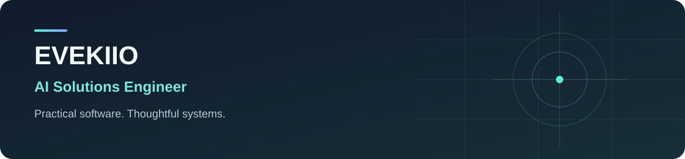

<picture>
  <source media="(max-width: 600px)" srcset="assets/portfolio-banner-mobile.svg">
  
</picture>

**AI Solutions Engineer** · Consultant · Builder

I build, break and figure things out. As a consultant, I make document workflows and automation tools for the work people need to get done. I also play games—and make them, because apparently playing wasn’t enough.

[Selected work](#selected-work) · [How I build](#how-i-build) · [Technical toolkit](#technical-toolkit)

## Selected work

### 01 / Rail Arena

**Game systems · Public source · Windows v1 alpha**  
C# · Unity 6.6 / URP · Blender · NUnit

A sci-fi arena FPS built around aim, momentum and finding a better angle. One rifle, floating gardens and plenty of reasons to queue one more match. Current source includes solo and target practice, offline matches against up to three bots and two-player direct-IP duels.

- **Combat and traversal:** a 250 RPM automatic rifle, 30-round magazines, reloads and 1.5x ADS, plus sprint slides, jump pads and portals with live views.
- **Simulation and networking:** host authority, client prediction and reconciliation, opponent interpolation and bounded hit rewind. An offline Physics Lab exposes movement settings for repeatable playtests.
- **Player experience:** Sky Gardens, four contender appearances, a branded menu and HUD, combat statistics and saved aim, reticle, comfort and audio settings.
- **Evidence:** the published alpha records 39 passing standalone mechanics checks and targeted movement, HUD, networking and hit-detection checks. AI assists development and concept exploration; the bots use gameplay logic.

[Explore source](https://github.com/Evekiio/rail-arena) · [Download v1 alpha](https://github.com/Evekiio/rail-arena/releases/tag/v1.0.0-alpha.1) · [Alpha status](https://github.com/Evekiio/rail-arena/blob/main/docs/ALPHA.md) · [Design](https://github.com/Evekiio/rail-arena/blob/main/docs/DESIGN.md)

> **Development boundary:** v1 alpha remains in active polish. Physical-input feel, sound, final visual approval, real-internet duels and measured rendering performance remain open. Automated checks cover specific builds and do not establish those acceptance results.

<strong>Visual development</strong>

Sky Gardens implements the measured Foundry-v2 layout as a playable scene with ramps, a high summit, portals, foliage and waterfalls. Its materials and experimental graphics remain under review. Earlier Foundry and Twin Platforms scenes are preserved.

Character and arena concept studies are AI-generated design references, not gameplay captures. Editable Blender sources and Unity assets support the production work; concept approval and final in-game art acceptance are separate.

[Sky Gardens implementation and limits](https://github.com/Evekiio/rail-arena/blob/main/docs/SKY-GARDENS-PLAYABLE.md) · [Character sources](https://github.com/Evekiio/rail-arena/blob/main/docs/STYLIZED-CONTENDERS.md) · [Physics Lab](https://github.com/Evekiio/rail-arena/blob/main/docs/PHYSICS-LAB.md)

---

### 02 / Windows System Audit

**Systems tooling · Public source · Local utility**  
PowerShell · Windows · JSON

A local PC inspection tool that turns hardware and Windows information into readable text and structured JSON for inventory, troubleshooting and workload planning. Collection gaps are shown explicitly; disk benchmarking is opt-in. Reports include hardware inventory and Windows versions and should be reviewed before sharing.

[Explore source](https://github.com/Evekiio/windows-system-audit) · [Run guide](https://github.com/Evekiio/windows-system-audit#quick-start) · [Privacy & limitations](https://github.com/Evekiio/windows-system-audit#privacy-and-security)

---

### 03 / Morrow

**Architecture · High-level overview**

Morrow is a modular, self-hosted business ecosystem intended to bring websites, customers, appointments and checkout together around a shared foundation.

## How I build

1. **Understand the problem:** start with the people, workflow and outcome that matter.
2. **Design the boundaries:** make ownership, inputs, failure paths and security considerations clear.
3. **Make the work inspectable:** validate the behavior, record its limits and distinguish implemented work from plans.

## Technical toolkit

- **Systems & automation:** Go, Python, PowerShell, REST APIs and JSON.
- **AI & documents:** AI-assisted development, document processing, RAG, Ollama and local AI integrations.
- **Games & real-time:** C#, Unity 6.6, URP, Blender and NUnit.
- **Web:** HTML, CSS, JavaScript, React, PHP, WordPress and MySQL.

[Browse public repositories](https://github.com/Evekiio?tab=repositories)
